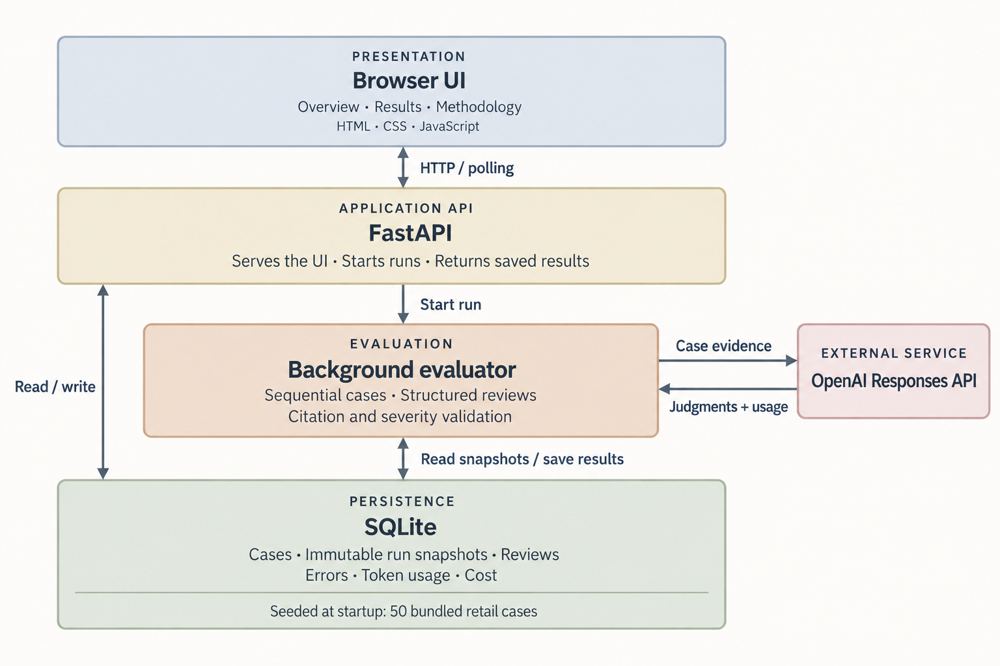

# Agentic Support Quality Reviewer

A local, evidence-led QA workbench for customer support. Python + uv, FastAPI, SQLite, the OpenAI Responses API, and a plain HTML/CSS/JavaScript UI. No frontend build step or external services beyond live inference.

## Architecture



The application has four layers:

- **Presentation:** a plain HTML/CSS/JavaScript UI for dashboards, run history, and case inspection. It calls the API and polls for evaluation progress.
- **Application API:** FastAPI serves the UI, handles case imports, starts evaluation runs, and returns saved results and summary metrics.
- **Evaluation:** a background task in the FastAPI process reviews cases sequentially, with four separate OpenAI Responses API calls per case (one per criterion). Each call sees the original evidence and only its own rubric. It checks the returned structure, citations, and severity before saving a review, and records failures per case.
- **Persistence:** SQLite stores the case corpus, run configuration, immutable case snapshots, reviews, errors, and usage metrics. Snapshots preserve the evidence used for past reviews even when cases are updated.

OpenAI is the only external runtime service; the UI, API, evaluator, and database run locally. Each run saves its case snapshots before evaluation, and results become available as individual cases finish.

## Run locally

Install [uv](https://docs.astral.sh/uv/getting-started/installation/), then:

```sh
uv sync
cp .env.example .env
uv run uvicorn reviewer.app:app --host 127.0.0.1 --port 8765
```

Open <http://127.0.0.1:8765>. The first launch imports **50 real τ³ Retail cases** into `data/reviewer.sqlite3`. Browse them in Results without an API key.


For live evaluation, put `OPENAI_API_KEY` in `.env` and restart the server. Click **New evaluation**, choose a model and batch size (1, 10, or 50), then start the run. The default model is `gpt-6-luna`; use any accessible Responses model supporting strict structured outputs. A run sends case evidence to OpenAI and incurs API charges. The app never puts the key in the browser. Only real dataset cases can be evaluated; there is no example mode. Start with one case to verify account/model access.

Pricing for cost estimates is configured in `.env`. Evaluation defaults to a 5-second pause between cases and 1 second between checks. Adjust `REVIEWER_CASE_DELAY_SECONDS` and `REVIEWER_CHECK_DELAY_SECONDS` (0–300 seconds), then restart. These delays reduce bursts; they cannot guarantee avoidance of account-wide token or request limits. A check pauses for manual resume if the next cooldown would exceed five minutes of total retry waiting. Usage/cost totals sum all check responses, including rejected output; check latency includes retry waits and excludes deliberate pacing.

## What is implemented

- **Overview:** distributions for all four criteria; independent flagged-case counts; separate model, token, latency, and cost observability.
- **Results:** run history, search, combinable outcome filters, and case inspection with objectives, chronological transcript/tool events, policies, initial/final states, and clickable source evidence.
- **Methodology:** all PRD outcomes, evidence sources, interpretations, and dataset provenance. No overall quality score.
- **Evaluation:** strict structured output, exact evidence path/quote validation, severity requirements, explicit prompt version/hash, persisted model configuration, immutable case snapshots, and per-case error isolation.
- **Persistence:** completed reviews survive failures. Each validated check is checkpointed. Temporary HTTP 429 limits retry up to five times, honoring Retry-After or using exponential backoff with jitter. Quota/billing errors, exhausted retries, and connection interruptions pause the run; use Resume unfinished checks after resolving the limit. Interrupted runs can also resume without repeating saved checks. Older shared-prompt runs remain readable but cannot be resumed under the new prompts. Runs execute sequentially to keep the MVP local and predictable. Run one Uvicorn worker; this is not a multi-user/public service.

## Dataset and provenance

The included [50-case dataset](data/tau3-retail-50.json) comes from the public [Qwen3.5-4B τ³ Retail trajectory package](https://huggingface.co/datasets/xiaomingneu/tau3-qwen35-4b-retail-baseline). These are simulated retail conversations, selected deterministically for scenario coverage rather than benchmark performance.

Cases retain conversation evidence, policies, tool calls, and system state, while excluding benchmark rewards, reference actions, and source evaluations. Final states are reconstructed by replaying recorded calls through pinned Sierra Retail tools. Source hashes, the upstream commit, and selection details are recorded in [the manifest](data/manifest.json); vendored tools use the [upstream MIT license](data/TAU_LICENSE).

To reproduce the dataset, download the trajectory JSON linked in the source package and the [matching database](https://raw.githubusercontent.com/sierra-research/tau2-bench/1901a301961cbbe3fd11f3e84a2a376530c759e3/data/tau2/domains/retail/db.json), then:

```sh
uv run python scripts/prepare_tau.py /path/to/qwen35_4b_retail_base_114x4.json /path/to/db.json
```

The script validates the pinned source and tool replay. Raw downloads are not needed at runtime; other datasets can be imported using the normalized `Case` schema.

## API and tests

Interactive API docs: <http://127.0.0.1:8765/docs>.

| Endpoint | Purpose |
| --- | --- |
| `GET /api/config` | Framework, dataset manifest, model default, API readiness |
| `GET /api/cases` | Corpus index |
| `GET /api/cases/{id}` | Normalized case evidence |
| `POST /api/cases/import` | `{ "cases": [...] }`; validate and atomically upsert normalized cases |
| `POST /api/runs` | `{ "mode": "openai", "model": "gpt-6-luna", "case_ids": [...] }` |
| `POST /api/runs/{id}/resume` | Resume a paused or interrupted current-version run, preserving completed checks |
| `GET /api/runs` | Run history and aggregate observability |
| `GET /api/runs/{id}` | Run summary and results; UI filters these locally |
| `GET /api/runs/{id}/cases/{case_id}` | Saved case snapshot, review, citations, usage, errors |

`case_ids` is optional (first 50 sorted IDs); explicit selection accepts 1–50 unique existing IDs. A second live run is rejected while one is active. Normalized import examples are in the included dataset; the exact schema is exposed in API docs. Upserting cases does not alter past runs.

```sh
uv run python -m unittest discover -s tests -v
```

Tests use temporary SQLite databases and a mocked OpenAI transport: corpus exclusion, structured output/citation validation, independent signals, immutable snapshots, missing key/errors, interrupted runs, and usage/cost accounting for rejected model outputs. No API charges during tests.

For a diagnostic evaluation that stops at the first error, run the local server and then:

```sh
uv run python scripts/evaluate_until_error.py
```

The diagnostic script saves attempts in `data/conversation-retry.json` and retries the failed case when rerun after a fix. Paused or interrupted current-version runs resume their unfinished checks. A new prompt version starts a fresh pass. Run one copy at a time; evaluations incur normal API charges.

After all 50 cases validate with the current prompt, run `uv run python -m scripts.collect_evaluation` to combine saved reviews into one dashboard view without new API calls. Its usage metrics reflect the original runs, so avoid counting them twice.

Reviews use structured outputs and citations selected from the original evidence. Invalid or refused responses remain explicit failures. Citation checks confirm that sources exist; human review is still needed to assess whether they support the model’s judgment.
